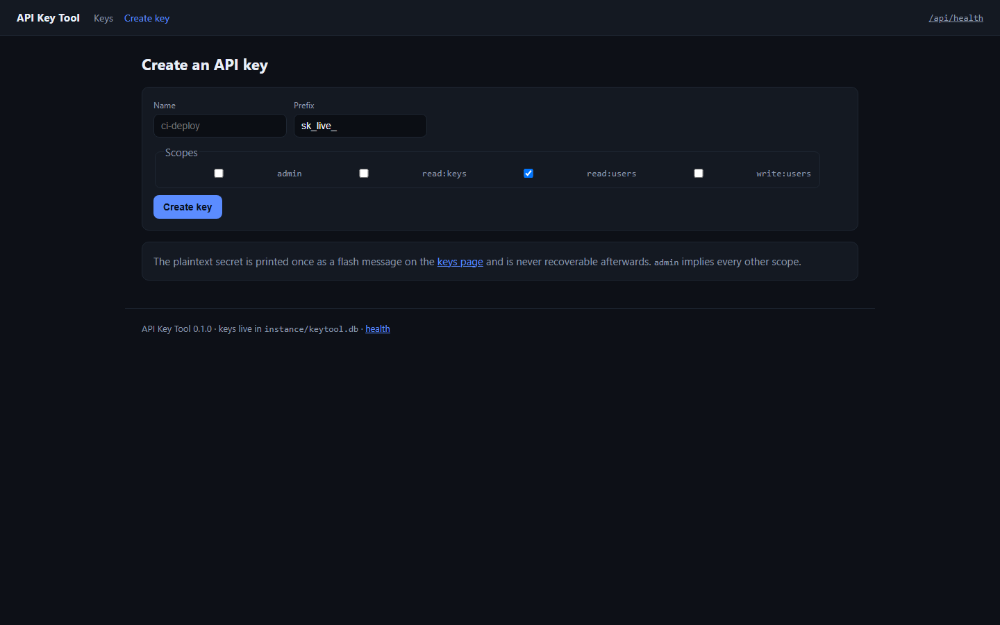
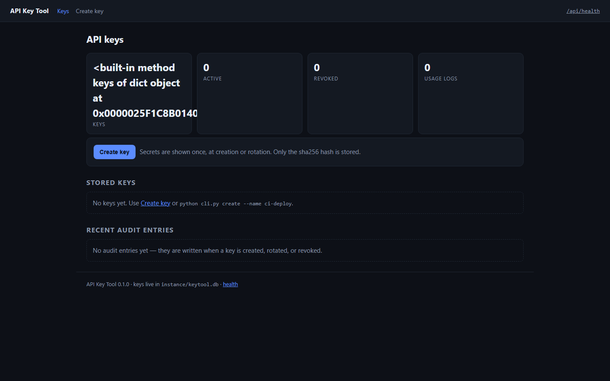
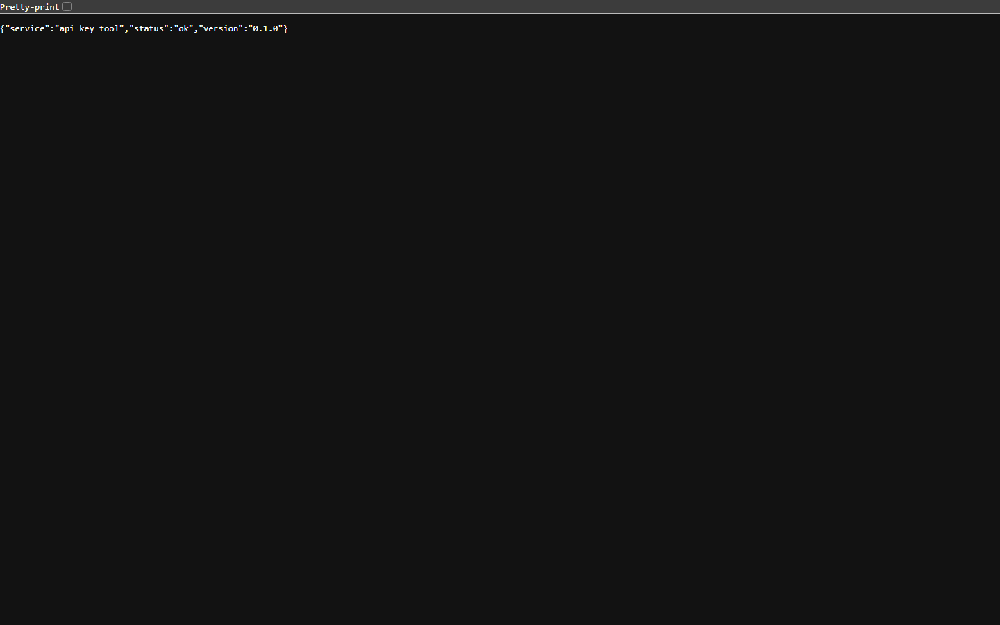
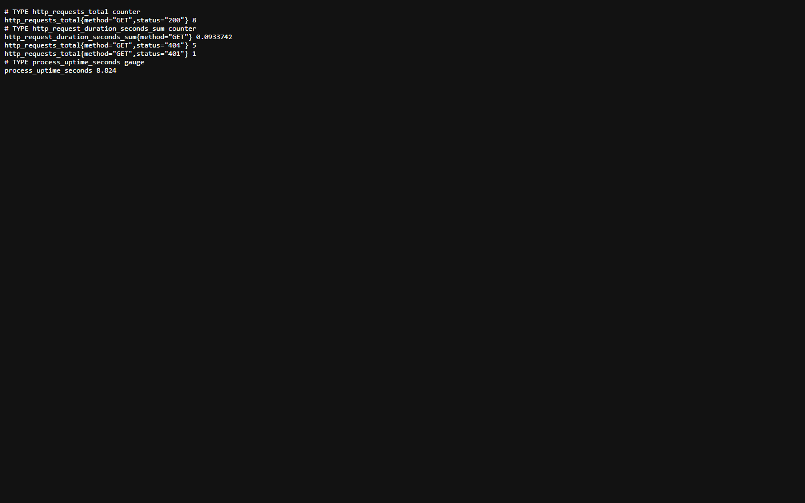
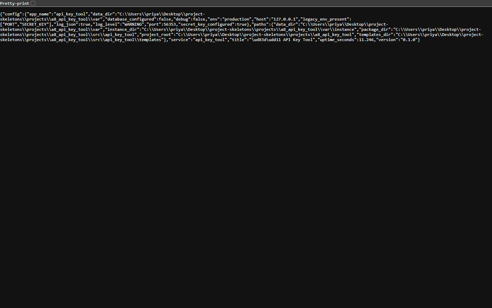

<p align="center">
  
</p>

<h1 align="center">keyforge</h1>

<p align="center"><b>Mint, rotate, revoke and audit API keys — the secret is shown once.</b></p>

<p align="center">
  <a href="#quality-gates"></a> <a href="#quality-gates"></a> <a href="#api"></a> <a href="#requirements"></a> <a href="LICENSE"></a>
</p>

keyforge is the key-issuing service every internal API ends up needing: create a key with a scope list and a quota, see the secret exactly once, rotate it without downtime, revoke it, and read an audit trail of who did what.

---

**Contents** &nbsp;·&nbsp; [Why](#why-this-exists) &nbsp;·&nbsp; [What it does](#what-it-does) &nbsp;·&nbsp; [Quickstart](#quickstart) &nbsp;·&nbsp; [API](#api) &nbsp;·&nbsp; [Screenshots](#screenshots) &nbsp;·&nbsp; [Measured](#measured-not-estimated) &nbsp;·&nbsp; [Architecture](#architecture) &nbsp;·&nbsp; [Quality gates](#quality-gates) &nbsp;·&nbsp; [Deploy](#deploy) &nbsp;·&nbsp; [Limits](#limits-stated-rather-than-hidden)

## Why this exists

Keys leak in three ways: the secret is stored recoverably, revocation is a boolean nobody checks, and there is no record of the rotation. keyforge stores only a hash, checks status on every request, and writes an audit row for every mutation.

## What it does

| Capability | How it works |
| --- | --- |
| **Hashed secrets** | Only a digest is stored; the plaintext is returned by the create call and never again. |
| **Scopes and quota** | Each key carries a scope list and a per-key quota; the example protected route checks both. |
| **Rotation and revocation** | Rotate replaces the digest and returns the new secret; revoke marks the row so the next request fails. |
| **Usage and audit** | GET /api/keys/<id>/usage returns recent calls; GET /api/audit returns the mutation log. |
| **HTML + API** | A /create page for humans, the same operations as JSON for services. |

## Quickstart

```sh
git clone https://github.com/scar8969/keyforge.git
cd keyforge
python -m venv .venv && . .venv/bin/activate   # Windows: .venv\Scripts\activate
pip install -e ".[dev]"
python wsgi.py                                 # http://127.0.0.1:8000
```

The same work from the CLI:

```sh
python -m api_key_tool.cli --help
```

Commands: `create`, `list`, `rotate`, `revoke`.

A first request:

```sh
curl -s http://127.0.0.1:8000/api/health | head
```

## Requirements

- Python **3.11+** — CI runs 3.11, 3.12 and 3.13.
- Runtime dependencies: `Flask>=3.0`, `Flask-SQLAlchemy>=3.1`, `SQLAlchemy>=2.0`, `PyYAML>=6.0`.
- No JavaScript build step: every page is server-rendered Jinja.

## API

Every route below is in [`openapi/keyforge.yaml`](openapi/keyforge.yaml) and is exercised by the live probe recorded in [`docs/EVIDENCE.md`](docs/EVIDENCE.md).

| Method | Path | What it does |
| --- | --- | --- |
| `GET` | `/api/health` | liveness probe |
| `GET` | `/api/keys` | list keys (secrets are never returned) |
| `POST` | `/api/keys` | mint a key; the secret is returned exactly once |
| `POST` | `/api/keys/{id}/rotate` | replace a key's secret |
| `POST` | `/api/keys/{id}/revoke` | mark a key revoked |
| `GET` | `/api/keys/{id}/usage` | last 100 usage entries for a key |
| `GET` | `/api/audit` | the 50 most recent audit-log rows |
| `GET` | `/api/users` | scope-protected example endpoint |
| `GET` | `/create` | HTML key-creation form |
| `POST` | `/keys/new` | create a key from the HTML form |
| `POST` | `/keys/{id}/rotate` | rotate a key from the HTML form |
| `POST` | `/keys/{id}/revoke` | revoke a key from the HTML form |
| `POST` | `/keys/{id}/delete` | delete a key from the HTML form |

## Screenshots

Captured from the running service with headless Chromium at 1440×900, one image per page, committed under [`docs/assets/screens/`](docs/assets/screens/).

<table>
<tr>
<td width="50%"><br><sub><code>/</code> &middot; 43.6 KB</sub></td>
<td width="50%"><br><sub><code>/healthz</code> &middot; 8.4 KB</sub></td>
</tr>
</table>

<table>
<tr>
<td width="50%"><br><sub><code>/livez</code> &middot; 7.3 KB</sub></td>
<td width="50%"><br><sub><code>/metrics</code> &middot; 16.2 KB</sub></td>
</tr>
</table>

<table>
<tr>
<td width="50%"><br><sub><code>/readyz</code> &middot; 7.7 KB</sub></td>
<td width="50%"><br><sub><code>/version</code> &middot; 26.7 KB</sub></td>
</tr>
</table>

## Measured, not estimated

These numbers were produced on this checkout by `pytest --cov` and by booting `wsgi.py` and issuing one real GET per documented path. The commands are in [`docs/EVIDENCE.md`](docs/EVIDENCE.md).

| Signal | Value |
| --- | --- |
| Tests | **25 / 25 passed** (2.9 s, exit 0) |
| Line coverage | **63.8%** — 478 of 717 statements |
| Source | 16 files / 1,555 lines |
| Test code | 4 files / 255 lines |
| Documented paths | 12 in the spec, 6 GET |
| Live probe | 12 GET requests to the booted app, **10 answered 200** |
| Median latency | **6.5 ms** (single uncached request, dev server) |
| Slowest / fastest | 74.1 ms `/` / 3.5 ms `/version` |
| Bytes served | 11.7 KB across 12 responses |
| Screenshots | 7 captured |

## Architecture

```
keyforge/
├── src/api_key_tool/
│   ├── http.py                         379  HTTP plumbing for api_key_tool: correlation ids, acc
│   ├── config.py                       172  Environment-driven configuration for api_key_tool
│   ├── observability.py                169  Structured logging and request correlation for api_k
│   ├── _app.py                         166  
│   ├── app.py                          119  Application factory for api_key_tool
│   ├── keys/api.py                     119  
│   ├── cli.py                          113  
│   ├── errors.py                       108  Typed application errors and their HTTP mapping for 
│   ├── models.py                        63  
│   ├── paths.py                         52  Filesystem layout for api_key_tool
│   ├── keys/quota.py                    41  
│   ├── keys/generator.py                18  
├── openapi/keyforge.yaml                  the contract of record
├── schema/keyforge.sql                    the DDL
├── tests/                       the suite that has to stay green
├── docs/EVIDENCE.md             the recorded live route walk
├── Dockerfile                   multi-stage build
└── wsgi.py                      entry point
```

The package keeps one shape across the service: `config.py` reads the environment once, `observability.py` emits structured JSON logs carrying a request id, `errors.py` turns exceptions into a single JSON envelope, `models.py` holds the tables, and the `keys/` package holds the routes.

## Quality gates

| Gate | Command | Threshold |
| --- | --- | --- |
| Suite | `pytest -q` | all green |
| Coverage | `pytest --cov` | floor set in `pyproject.toml` from the measured value |
| Lint | `ruff check src tests` | zero findings |
| Format | `ruff format --check src tests` | zero reformats |
| Types | `mypy src` | zero errors |
| Security | `bandit -c pyproject.toml -r src` | reviewed skip list, no unreviewed finding |
| Live routes | boot `wsgi.py`, one GET per documented path | no 5xx, no undocumented guard |

CI runs the first six on Python 3.11, 3.12 and 3.13 for every push to `main`, plus a container build. See [`.github/workflows/ci.yml`](.github/workflows/ci.yml).

## Deploy

```sh
docker build -t keyforge .
docker run --rm -p 8000:8000 --env-file .env.example keyforge
```

Configuration is environment-only — every variable is documented in [`.env.example`](.env.example), and the service refuses to start with a production secret missing.

## Limits, stated rather than hidden

- Keys are verified by this service; downstream services must call the verify path or share the digest table.
- Quota counters are per key and reset on a fixed window, not a rolling one.

## License

MIT — see [LICENSE](LICENSE).
