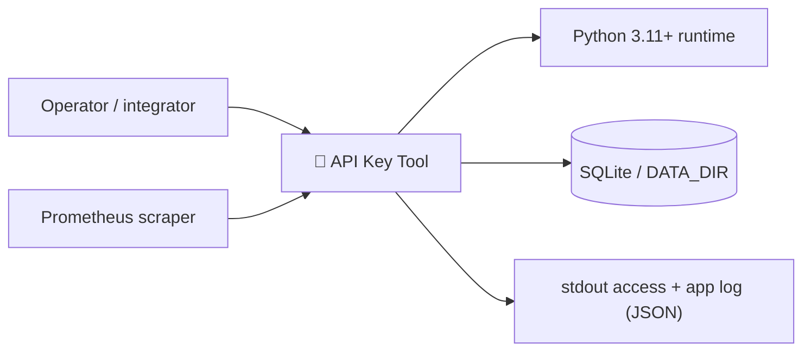
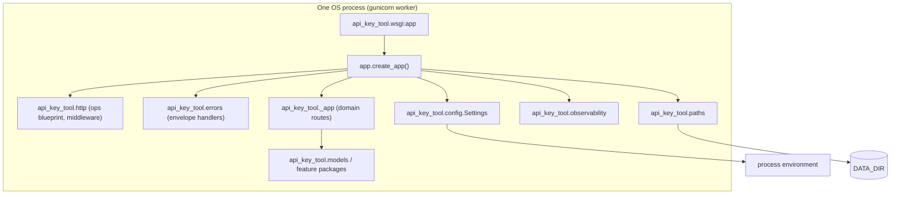
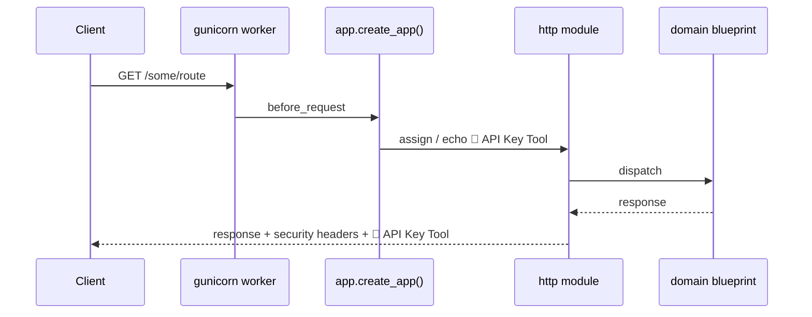

# Architecture -- 🔑 API Key Tool

Issue, rotate, revoke, and audit API keys. Each key carries a scope list and a

This document explains how the service is put together, why the seams sit where
they do, and what breaks first under load.

---

## 1. Context

a8_api_key_tool is a single-process Flask service. It owns its own database (SQLite by
default, any SQLAlchemy-supported backend via `DATABASE_URL`) and is deployed
behind a reverse proxy or an orchestrator.

There is no message broker, no cache tier and no second service. Every scaling
decision below follows from that: the unit of scale is a process, and shared
state lives in the database.

---

## 2. Container view

| Component                 | Responsibility                                                |
| ------------------------- | ------------------------------------------------------------- |
| `wsgi.py` / gunicorn      | Process entry point, worker lifecycle, healthcheck target     |
| `api_key_tool.app`             | App factory: config, directories, logging, middleware, ops endpoints |
| `api_key_tool.config`          | Environment parsing and validation; the only place the environment is read |
| `api_key_tool.paths`           | Filesystem layout; the only place runtime paths are decided   |
| `api_key_tool.observability`   | Structured logging, request-scoped correlation ids            |
| `api_key_tool.http`            | Middleware, error envelopes, hand-rolled Prometheus exposition |
| `api_key_tool.errors`          | Typed exception hierarchy that maps to HTTP status codes      |
| `api_key_tool.<feature>`       | The service's own domain modules (see below)                  |

---

## 3. Domain modules

| Module | Kind |
| --- | --- |
| `cli.py` | module |
| `keys/__init__.py` | module |
| `keys/api.py` | module |
| `keys/generator.py` | module |
| `keys/models.py` | module |
| `keys/quota.py` | module |
| `keys/scopes.py` | module |
| `models.py` | module |
| `templates/base.html` | asset |
| `templates/create.html` | asset |
| `templates/index.html` | asset |
| `tests/test_a8_api_key_tool.py` | module |
| `_app.py` | asset |

---

## 4. Request lifecycle

Step by step:

1. gunicorn accepts the connection and hands it to a worker process.
2. Flask builds the request. The `before_request` hook reads `X-Request-ID`
   or generates one, stores it in a `ContextVar`, and starts a monotonic timer.
3. The matching view runs. Domain code may raise an `AppError` subclass; a
   registered error handler renders it to the standard JSON envelope.
4. The `after_request` hook stamps security headers, echoes the request id,
   and increments RED counters (rate, errors, duration) per route and status class.
5. An access record is emitted as one JSON line. `/metrics`, `/healthz`,
   `/livez` and `/readyz` are excluded so probes do not drown the log.

Because the request id lives in a `ContextVar` rather than a thread local, it
propagates correctly through gunicorn's threaded workers, and it stays correct if
the worker model later becomes async.

---

## 5. Configuration and startup

Configuration is parsed once, when the factory imports, into a frozen dataclass.
`Settings.validate()` runs inside `from_env()`, so an invalid manifest
fails at boot instead of at the first request. Startup order is deliberate:

1. Parse and validate the environment.
2. `ensure_runtime_dirs()` creates `var/`, `var/instance`, `var/log`.
3. `configure_logging()`, before any other code can log.
4. Import the project's Flask app and apply the platform configuration.
5. Re-point `instance_path` at `var/instance` so a relative SQLite URI
   resolves under the writable data directory rather than inside the source tree.
6. Install middleware, error handlers and the ops blueprint.

Step 5 is what makes the image work with a read-only root filesystem: nothing
writable lives under `/app`.

---

## 6. Data

| Table | Owner |
| --- | --- |
| `keys` | owned by `a8_api_key_tool` |
| `usage_logs` | owned by `a8_api_key_tool` |
| `audit_logs` | owned by `a8_api_key_tool` |

Tables are created by the application's own bootstrap on first use. No migration
tool is wired in; the schema is additive, and the service tolerates a missing or
empty database by creating what it needs.

---

## 7. Failure modes

| Failure                         | Behaviour                                                   |
| ------------------------------- | ----------------------------------------------------------- |
| Database unreachable            | Requests needing it return `503`; `/readyz` reports the failure |
| Database empty or never migrated | The schema is created on demand; no manual step required   |
| Downstream service unreachable  | Route-specific behaviour, documented in the route table     |
| Oversized request body          | `413` with the standard envelope (`MAX_CONTENT_LENGTH`)      |
| Unhandled exception             | `500` with the envelope; the traceback goes to the log, never the body |
| Worker OOM-killed               | The orchestrator restarts it on the failed `/healthz` probe   |

Failures are collected through `errors.AppError`. Anything raised that is not
an `AppError` is treated as a bug: it is logged with a full traceback and
reported to the client as a bare `500`.

---

## 8. Scaling

The service is stateless apart from the database, so the scale-out story is "add
workers, add replicas":

- **Vertically:** raise `--workers`. A reasonable starting point is
  `2 * CPU + 1` for request-bound work; measure before trusting that rule.
- **Horizontally:** run N replicas behind a load balancer. Nothing is sticky.
- **SQLite is the ceiling.** Its single-writer lock makes multi-replica writes
  unsafe on a shared filesystem. Move `DATABASE_URL` to Postgres before
  scaling past one writer, and use `/readyz` as the traffic gate.
- **Metrics** are per-process and in memory. Aggregating across replicas is the
  scrape layer's job, which is why every counter is labelled with the route
  template rather than the raw path.

---

## 9. Security posture

- Secrets come from the environment only. `Settings.as_dict()` redacts them
  and `/version` therefore cannot leak one.
- Security headers are applied centrally, so a new route cannot forget them.
- The container drops all Linux capabilities, runs as an unprivileged uid, and
  mounts a read-only root filesystem.
- The threat model -- what is defended and what is explicitly not -- is in
  [SECURITY.md](../SECURITY.md). It states plainly that this service has no
  authentication layer unless the route table says otherwise.

---

## 10. Decisions

Architecture decisions are recorded as ADRs in [docs/adr/](adr/). The first one
explains why the source layout is `src/` and why runtime state lives under
`var/`.
